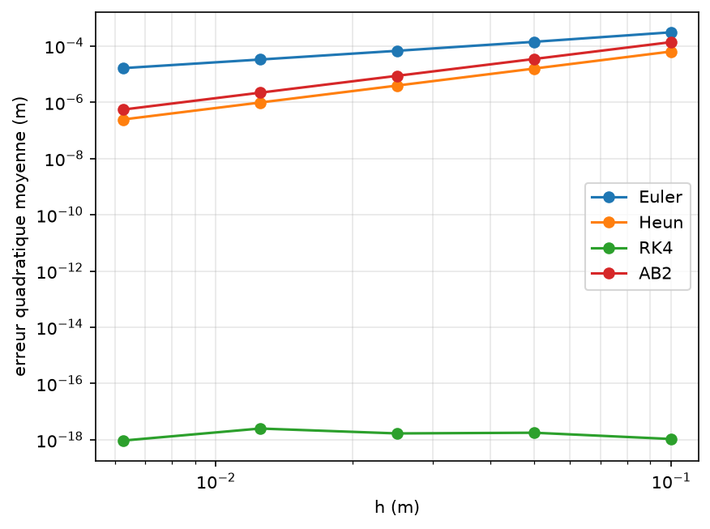

# Flexion d'une poutre encastrée – Fortran

Déformée d'une poutre cylindrique encastrée, soumise à son poids et à une masse en bout. Première étape d'un TER d'équipe sur le shaft de golf (ENSEIRB-MATMECA, 2024-2025) ; j'ai écrit le code de ce dépôt.

E·I·w″ = M(x) est réécrit en système d'ordre 1, puis comparé à la solution analytique.

| Schéma | Erreur, h = 0,1 m | Erreur, h = 0,00625 m | Ordre |
|---|---:|---:|---:|
| Euler explicite | 3,06·10⁻⁴ | 1,63·10⁻⁵ | 1,02 |
| Heun | 6,36·10⁻⁵ | 2,43·10⁻⁷ | 2,00 |
| Adams-Bashforth 2 | 1,37·10⁻⁴ | 5,48·10⁻⁷ | 2,00 |
| RK4 | 10⁻¹⁸ | 10⁻¹⁸ | exact |

RK4 est exact à l'arrondi, car la solution est un polynôme de degré 4.



## Lancer
```sh
make
./main 0.01               # pas en mètres, 0,001 par défaut
python3 convergence.py    # NumPy, Matplotlib
```
